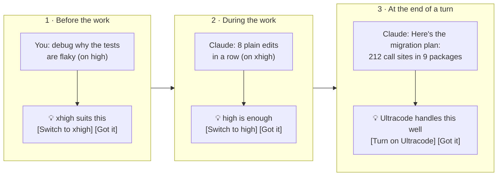
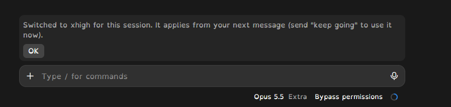
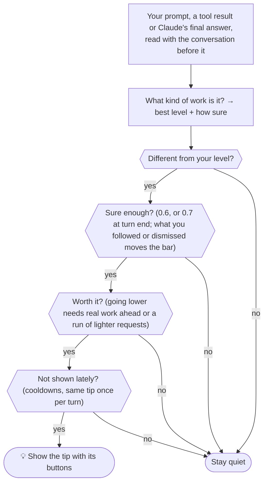

# Effort Advisor for Claude Code

**It tells you when to switch Claude's reasoning effort**, from low to max, and whether Ultracode is worth it, before, during and after a task. One click on **Switch** changes the level for this session, exactly as if you typed `/effort <level>`. It never switches on its own.

- In the desktop app, the tip appears as a band above the prompt box, with the buttons.
- You can still switch by hand: the effort menu next to the model picker (where xhigh is called **Extra**), or `/effort <level>` in a terminal.

*An independent community project. It is not made, endorsed or supported by Anthropic.*


## In 30 seconds

- 💡 **It speaks at three moments:** before the work, when the work changes, and at the end of a turn.
- 🔁 **One click switches:** **Switch to xhigh** runs `/effort xhigh` for this session. **Turn on Ultracode** and **Turn off Ultracode** do the same for Ultracode.
- 🧠 **It follows the conversation:** "yes, do it" takes the level of what it accepts; a bug that survives two fixes is tricky debugging; three small requests in a row are a run of light work.
- 🤫 **It stays quiet otherwise, and learns:** tips you dismiss get rarer, tips you follow come more readily. It keeps counts only.
- 🔒 **Local and free:** no network, your prompts are never stored, and Claude never reads the tips.



## Install

You need a Claude Code version with mods (plugins that run inside Claude Code). It was built and tested on Claude Code 2.1.317, in the Windows desktop app. Install it **one way only**: two installs show every tip twice. It takes effect in new sessions.

| Where | How |
| --- | --- |
| A terminal session | Type `/plugin install effort-advisor --marketplace rozhrr2/claude-effort-advisor`, answer `y`, then pick a scope (user scope covers every project) |
| A shell | `claude plugin install effort-advisor --marketplace rozhrr2/claude-effort-advisor` |
| The desktop app | Click **+** next to the prompt box, choose **Plugins**, then **Add marketplace** with `rozhrr2/claude-effort-advisor`, then **Add plugin** |

The install screen shows six settings. The defaults are fine.

**Check it works.** The advisor is quiet by design, so test it once:

1. Start a new session on a current model, such as Opus 5.5, and set the effort to **high**.
2. Send `debug why the tests are flaky on Windows only`.

A band should appear above the prompt saying **xhigh suits this**, with **Switch to xhigh** and **Got it**.

The mod itself needs nothing else. Node.js 22 or later is needed only for the scripts, tests and fallback hook in a local clone.

## The buttons

| Button | What it does |
| --- | --- |
| **Switch to *level*** | Runs `/effort <level>` for this session, exactly as if you typed it. Claude uses the new level from your next message, so mid-task, send "keep going". |
| **Turn on Ultracode** / **Turn off Ultracode** | Runs `/effort ultracode on` or `off` for this session. |
| **Got it** | Dismisses the tip. Tips of that kind then need a little more confidence before they show again. |

The desktop app's effort menu calls xhigh **Extra**, so in the desktop app the tips do too: **Switch to Extra (xhigh)**. A terminal keeps plain xhigh. After the switch, the band confirms it and the effort menu moves with it (these screenshots were taken just before the tips used the desktop name):



The commands appear in the transcript like ones you typed. Nothing is written to your settings files, and a new session starts at your usual level.

## Try it without installing

You can try the same classifier from a shell, without installing the plugin. Clone the repo first; this needs Node.js 22 or later:

```bash
git clone https://github.com/rozhrr2/claude-effort-advisor.git && cd claude-effort-advisor
```

Pass a prompt, and use `--on` for the level you are on:

```bash
node scripts/try.mjs "debug why the tests are flaky on Windows only" --on high
```

```text
Prompt: "debug why the tests are flaky on Windows only"
You're on: high
Looks like: tricky debugging (debugging, hard failure)
Best level: xhigh (confidence 0.95)
Shows: Effort tip: xhigh suits this (tricky debugging); you're on high. To use it for this task,
pick xhigh in the effort menu next to the model picker, then send "keep going".
```

Add `--end "a final answer"` to try the end-of-turn tip instead. `try.mjs` judges one message on its own; in Claude Code the advisor also reads the conversation before it.

## Examples

These are real outputs of the advisor and its tests.

| You're on | What happens | What it shows |
| --- | --- | --- |
| high | You: *debug why the tests are flaky on Windows only* | 💡 **xhigh** suits this (tricky debugging), as in the screenshot above |
| high | You: *design the architecture for the sync service and write a spec with trade-offs* | 💡 **max** suits this (a design or architecture decision) |
| max | You: *add a --dry-run flag to the install script and write tests for it* | 💡 **high** is enough (everyday build or fix work) |
| max | You: *add a loading spinner to the submit button on the login form* | 🤫 nothing: one small request is over before a switch pays off |
| max | You: *review this PR before I merge it* | 🤫 nothing: max is a fair choice for a review |
| high | You: *add a --dry-run flag to the install script and write tests for it* | 🤫 nothing: high is already right |
| xhigh | You: a third small request in a row (a colour, a sticky header, a font size) | 💡 your recent requests are lighter, so **medium** is enough |
| high | You: *nope, same thing*, after two of Claude's fixes did not hold | 💡 **xhigh** suits this (tricky debugging) |
| max | You: *go with redis*, after Claude laid out three options | 💡 **high** is enough (you picked an option: building it) |
| high | Mid-task: three test runs fail in one turn | 💡 **xhigh** may help (tricky debugging) |
| xhigh | Mid-task: eight plain edits in a row | 💡 **high** is enough (straightforward edits) |
| max | Claude ends with *The plan is ready. Want me to implement it?* | 💡 next step: **high** should be enough |
| high | Claude ends with *There are three ways out: a queue, async sends, or batching. Which do you prefer?* | 💡 next step (a design decision): **max** may help |
| high | Claude ends with *I could not reproduce the crash; the root cause is still unknown.* | 💡 next step: **xhigh** may help |

And for Ultracode:

| Ultracode | What happens | What it shows |
| --- | --- | --- |
| off | You: *audit the entire codebase for unsafe sql queries* | 💡 a broad sweep with many independent parts, which Ultracode handles well [**Turn on Ultracode**] |
| on | You: *rename the helper to formatDate* | 💡 Ultracode is on, but this is a small edit [**Turn off Ultracode**] |
| off | Claude ends with *Here's the migration plan: 212 call sites across 9 packages, in 5 phases.* | 💡 a next step with many independent parts [**Turn on Ultracode**] |


## Where tips appear


The band (1) carries the buttons. The toast (2) repeats the tip briefly. The line beneath the answer (3) is off by default; turn it on with `display.beneathAnswer` in `config.mjs`.

## How it decides



| Kind of work | Level it suggests |
| --- | --- |
| Quick questions, small edits, chores | medium, and only after several in a row |
| Building, fixing, tests, installs | high, the everyday default |
| Tricky debugging (intermittent, only on CI, still failing after fixes), reviewing a big or security-sensitive change | xhigh |
| Specs, architecture or design decisions, hard research that compares many options | max |
| A broad sweep (dead code across the codebase, every place that logs X) | high: Ultracode covers the breadth, and each part is ordinary work |

Cue words shift a level. "Quick" lowers it, unless the request is clearly long. "Carefully", "tricky", "go deeper" and long multi-part requests raise it.

**It reads the conversation, in memory only:**

- A follow-up ("yes, do it", "go with option 2", "now the tests") takes the level of the work it continues.
- A bug still failing after two of Claude's fixes is tricky debugging, whatever the next message says, until you say it works.
- Three or more small requests in a row are a run of light work. Short messages with no clear signal extend a run but cannot start one.
- At the end of a turn it reads the whole answer: options and a question mean a design decision is next; a plan or a recommendation means building; an open bug means more debugging.

**When it suggests going higher:** for substantial work, or work that is hard by nature (tricky debugging, reviews, design). One small build request ("add a `--verbose` flag") stays quiet, and one level up needs more confidence than a jump of two.

**When it suggests going lower:**

- Never for one small request. It needs real work ahead (two or more actions, a list, a long request) or a run of lighter requests.
- Usually across a gap of two levels or more. One step down is suggested from max for ordinary work (at 0.75 confidence), from xhigh for long work (at 0.8), after a long run of routine edits, after several light requests, and when building starts after a design discussion.
- Never one step down from max for hard debugging, reviews or design: max is a fair choice there.

**Ultracode** runs multi-agent workflows on every task and uses much more. It is suggested **on** for work that splits into many independent parts: a whole-codebase audit, a migration across many files, an exhaustive search or research sweep. It is suggested **off** for small or everyday work while it is on. One coherent change ("review this PR", "the bugs in this function") never counts as many parts, and a prompt that names Ultracode is left alone: you already chose.

When a tip is ignored, it waits twice as long before it is shown again. It also never names a level the model's menu lacks: the 4.5 and 4.6 models have no xhigh, and the 4.5 models have no max either.

## It learns from your choices

- It counts, per kind of tip (moment, kind of work, direction), how often you followed it, dismissed it, ignored it, or picked a level yourself.
- Tips you follow come more readily; tips you dismiss need more confidence next time, up to +0.3.
- It keeps the counts only, never text, in the plugin's own storage.
- `/effort-advisor status` shows what it has learned. `/effort-advisor reset` clears it. The **Learn from my choices** setting turns learning off.

## How well it predicts

It was stress-tested on labelled situations. Each case says what a careful expert would want: the best level, the acceptable range, whether a tip is worth showing, and what to do about Ultracode. The rubric is in [`tests/eval/README.md`](tests/eval/README.md). Independent checkers disputed none of the 100 blind cases they sampled; an early audit of the tuning set agreed with 90% of its tip labels.

The honest number is the last row: 150 cases written after all tuning, by writers who never saw the code.

| Case set | Cases | v0.1 | v0.2 |
| --- | --- | --- | --- |
| Tuning set: the advisor was improved against these | 405 | 50.6% | 91.1% |
| Held-out set: first honest test, then a second tuning round | 200 | 48.5% | 82.5% (51.5% before that round) |
| **Final test: never tuned against** | **150** | **48.0%** | **69.3%** |

On the final test:

| | v0.1 | v0.2 |
| --- | --- | --- |
| Tip decisions right | 60.7% | 74.0% |
| A tip when none was needed | 8.1% | 9.3% |
| No tip when one was needed | 81.3% | 45.3% |
| Ultracode advice right | 80.0% | 91.3% |

So v0.2 catches more than half of the moments that deserve a tip, where v0.1 caught under a fifth, and it is not noisier. What still trips it up is language its word lists don't know:

- bug reports in plain words ("still getting 502s, a few an hour");
- build requests without the usual verbs ("support a `fields` query param on the orders API");
- conceptual questions about hard topics ("what's the difference between read committed and repeatable read"), which it reads as design work;
- end-of-turn reports of finished work, after which a lower level would do.

Run `node scripts/eval.mjs --dir tests/eval/fresh` to reproduce the final test.

## Settings

The six settings appear in `/config` after install:

| Setting | Default | Effect |
| --- | --- | --- |
| Minimum confidence | 0.6 | How sure it must be before it shows a tip; higher means fewer tips |
| Show toasts | on | Toasts on or off. The band shows tips either way |
| Mid-task tips | on | Tips when a task turns into debugging or routine edits |
| Turn-end tips | on | A tip for the likely next step |
| Ultracode hints | on | Suggest Ultracode on for broad sweeps and off for small tasks; turn off if your Claude Code has no Ultracode |
| Learn from my choices | on | Adjust how readily each kind of tip appears from what you follow or dismiss |

For deeper tuning, clone the repo, install from the clone, and edit [`config.mjs`](config.mjs): uncomment a line and change it. Values in that file win over the settings rows.

```bash
git clone https://github.com/rozhrr2/claude-effort-advisor.git
```

```bash
node claude-effort-advisor/scripts/install.mjs claude-mod
```

This adds the folder to `CLAUDE_CODE_PLUGIN_DIRS` in your Claude settings (`$CLAUDE_CONFIG_DIR/settings.json`, or `~/.claude/settings.json`). It backs that file up to a `backups` folder beside it first. If your organisation's policy blocks plugins loaded this way, install from the marketplace instead.

| `config.mjs` key | Default | What it does |
| --- | --- | --- |
| `downshiftMinSteps` | 2 | How big a gap a lower-level tip needs, outside the one-step cases above |
| `maxSingleStepConfidence` | 0.75 | How sure it must be to suggest one step down |
| `downshiftFloor` | `"medium"` | Never suggests below this unless you ask for a level by name |
| `sustainedWindow` | 3 | Light requests in a row before a lower-level tip |
| `contextMessages` | 8 | How many earlier messages it reads, in memory, to judge follow-ups |
| `cooldownPrompts` / `maxCooldownPrompts` | 3 / 24 | How long the same tip waits; the wait doubles each time it is ignored |
| `debugFailureThreshold` | 3 | Failed tool runs in one turn before the debugging tip |
| `mechanicalEditThreshold` | `{ max: 6, xhigh: 8 }` | Edits in a row before the "high is enough" tip |
| `learning` | true | Learn from what you follow or dismiss |
| `display` / `events` | band and toast on, `beneathAnswer` off; all three moments on | Which places (`band`, `toast`, `beneathAnswer`) and moments (`prompt`, `midTask`, `stop`) are used |
| `ultracodeHints` | true | Ultracode on and off suggestions |

The words it listens for are the signal lists in [`lib/core.mjs`](lib/core.mjs). If a kind of request is often misjudged, add a phrase there and a case to [`tests/eval/cases/`](tests/eval/cases/), then run `node scripts/eval.mjs` to check that nothing else got worse.

## Uninstall

| Installed with | Remove with |
| --- | --- |
| `/plugin install` | `/plugin uninstall effort-advisor` |
| `claude plugin install` | `claude plugin uninstall effort-advisor` |
| A local clone | `node claude-effort-advisor/scripts/install.mjs claude-mod --uninstall` |

To pause it without uninstalling, turn it off in the plugin list, or set `enabled: false` in `config.mjs` in a clone.

## Fallback: a classic command hook

If your Claude Code has no mods, a local clone can register a plain command hook instead.

- It covers the same three moments. Tips show as a one-line "UserPromptSubmit says: …" note, with no buttons.
- It cannot see whether Ultracode is on, so it only ever suggests turning it on.
- Each event costs about 0.1 s for Node to start.
- It needs Node.js 22 or later, and a Claude Code version with the `PostToolBatch` event and exec-form hooks. It was tested on 2.1.317.
- The hook runs the `node` found on your PATH. Re-run the install after you move or upgrade Node.

```bash
node claude-effort-advisor/scripts/install.mjs claude-hooks
```

To remove it, run the same command with `--uninstall`. Options:

- `channel: "context"` in `config.mjs` makes Claude mention the tip in one line instead. That costs a few tokens and drops turn-end tips.
- `logDecisions: true` keeps a label-only log for tuning. `node claude-effort-advisor/scripts/stats.mjs` summarises it.
- `EFFORT_ADVISOR_ROUTER_PATH` can point at an ES module that exports `classifyPrompt(prompt)` returning `{ taskMode }`.
  - The task mode must be one of `diagnose`, `research_or_review`, `change_or_build` or `answer_or_explain`.
  - It only strengthens a match the built-in signals already found, and only in this fallback hook.

## How it is built

| Part | What it does |
| --- | --- |
| [`lib/core.mjs`](lib/core.mjs) | Pure logic, no I/O: weighted signal lists sort a message into a kind of work, the conversation decides what a follow-up continues, and a policy decides whether to speak |
| [`hooks/register.tsx`](hooks/register.tsx) | The mod. It classifies when a turn starts, reads the turn's real effort from the first model request, counts failed tool runs and edit streaks, reads the final answer at turn end, and draws the band with its buttons |
| [`command-hook/`](command-hook/) | The fallback hook. A prompt hook gets no reliable current level, so it uses the transcript or saved state; with neither, it waits for the first tool batch |
| [`scripts/`](scripts/) | `try.mjs` (try it), `eval.mjs` (score the advisor on labelled cases), `install.mjs` (local install), `stats.mjs` (tuning log) |
| [`tests/eval/`](tests/eval/) | The labelled cases and the rubric they follow |

Research, sources and the design choices: [RESEARCH.md](RESEARCH.md).

## Privacy and safety

- Prompts, earlier messages and answers are read in memory to classify them, and never written anywhere.
- The mod keeps only levels, counters and the learning counts.
- The fallback hook keeps per-session counters in `%LOCALAPPDATA%\effort-advisor` (`~/.local/state/effort-advisor` elsewhere). These are labels only, deleted after three days.
- No network calls and no blocking decisions. A hook that fails is skipped, and the prompt or tool goes on.
- It changes a level or Ultracode only when you press a button, and only for the session.

## Tests

From a local clone (Node.js 22 or later):

```bash
cd claude-effort-advisor
```

```bash
node --test "tests/node/*.spec.mjs"
```

```bash
claude plugin test .
```

```bash
node scripts/eval.mjs
```

- The Node tests cover the classifier, the policy, the hook's input and output, and the install script.
- `claude plugin test` runs the mod's tests in Claude Code's own engine test kit, including the buttons and drawing the band on the terminal and desktop surfaces.
- `eval.mjs` scores the advisor on the labelled cases in `tests/eval/cases/`; `--dir tests/eval/fresh` runs the final test, and `--failures 20` lists the misses.

## Limits

- Its heuristics are keyword-based and English only. On unseen situations it gets about 7 in 10 right (see [How well it predicts](#how-well-it-predicts)), and it stays quiet when it can't tell. Cooldowns stop a wrong tip from repeating, and dismissing a tip makes that kind rarer.
- The mod API is early access and can change between Claude Code releases. If a release breaks it, its hooks are skipped and Claude Code carries on.
- The buttons run `/effort` for you; the advisor never changes a level without a press. A level picked mid-turn applies from your next message.
- Ultracode advice needs a Claude Code build with `/effort ultracode` (2.1.317 has it).
- Which levels each model offers comes from a small built-in table (Claude Code 2.1.317). It assumes a model it doesn't know offers all five.

## Credits and licence

MIT, see [LICENSE](LICENSE). The heuristics adapt ideas, not code or model weights, from the projects credited in [RESEARCH.md](RESEARCH.md). The screenshot is from the author's own desktop session.

Effort Advisor is an independent community project. It is not made, endorsed or supported by Anthropic. Claude and Claude Code are trademarks of Anthropic.
