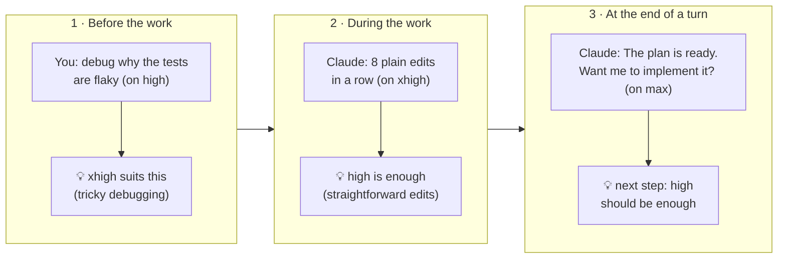
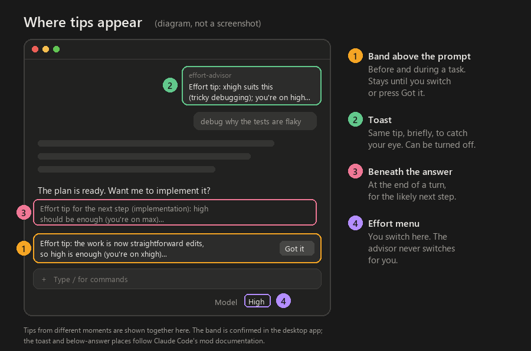
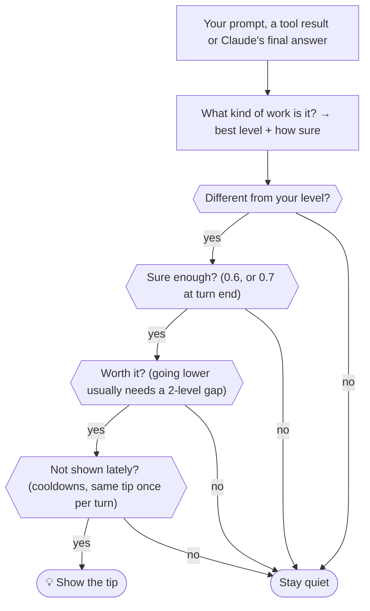

# Effort Advisor for Claude Code

**It tells you when to switch Claude's reasoning effort**, from low to max, before, during and after a task. It only suggests, and you decide:

- In the desktop app, use the effort menu next to the model picker.
- In a terminal, type `/effort <level>`, or use the arrow keys in `/model`.

*An independent community project. It is not made, endorsed or supported by Anthropic.*


## In 30 seconds

- 💡 **It speaks at three moments:** before the work, when the work changes, and at the end of a turn.
- 🤫 **It stays quiet otherwise.** It needs to be fairly sure a different level fits, and it doesn't repeat itself.
- 🔒 **It runs locally:** no network, no settings changed, and your prompts are never stored.
- 🪶 **It costs nothing:** tips are display-only, so Claude never reads them.



## Install

You need a Claude Code version with mods (plugins that run inside Claude Code). It was built and tested on Claude Code 2.1.317, in the Windows desktop app. Install it **one way only**: two installs show every tip twice. It takes effect in new sessions.

| Where | How |
| --- | --- |
| A terminal session | Type `/plugin install effort-advisor --marketplace rozhrr2/claude-effort-advisor`, answer `y`, then pick a scope (user scope covers every project) |
| A shell | `claude plugin install effort-advisor --marketplace rozhrr2/claude-effort-advisor` |
| The desktop app | Click **+** next to the prompt box, choose **Plugins**, then **Add marketplace** with `rozhrr2/claude-effort-advisor`, then **Add plugin** |

The install screen shows five settings. The defaults are fine.

**Check it works.** The advisor is quiet by design, so test it once:

1. Start a new session on a current model, such as Opus 5.5, and set the effort to **high**.
2. Send `debug why the tests are flaky on Windows only`.

A band should appear above the prompt saying **xhigh suits this**. Pick **Got it** to dismiss it.

The mod itself needs nothing else. Node.js 22 or later is needed only for the scripts, tests and fallback hook in a local clone.

## Try it without installing

You can try the same classifier from a shell, without installing the plugin. Clone the repo first; this needs Node.js 22 or later:

```bash
git clone https://github.com/rozhrr2/claude-effort-advisor.git && cd claude-effort-advisor
```

Pass a prompt, and use `--on` for the level you are on:

```bash
node scripts/try.mjs "debug why the tests are flaky on Windows only" --on high
```

```text
Prompt: "debug why the tests are flaky on Windows only"
You're on: high
Looks like: tricky debugging (debugging, hard failure)
Best level: xhigh (confidence 0.95)
Shows: Effort tip: xhigh suits this (tricky debugging); you're on high. To use it for this task,
pick xhigh in the effort menu next to the model picker, then send "keep going".
```

Add `--end "a final answer"` to try the end-of-turn tip instead.

## Examples

These are real outputs of `scripts/try.mjs` and the tests.

| You're on | What happens | What it shows |
| --- | --- | --- |
| high | You: *debug why the tests are flaky on Windows only* | 💡 **xhigh** suits this (tricky debugging) |
| high | You: *design the architecture for the sync service and write a spec with trade-offs* | 💡 **max** suits this (a design or architecture decision) |
| max | You: *add a --dry-run flag to the install script and write tests for it* | 💡 **high** is enough (everyday build or fix work) |
| max | You: *review this PR before I merge it* | 💡 **xhigh** is enough (reviewing a big change) |
| high | You: *add a --dry-run flag to the install script and write tests for it* | 🤫 nothing: high is already right |
| high | You: *yes, go ahead* | 🤫 nothing: a confirmation keeps the task's level |
| high | You: *quick question: which file holds the config?* | 🤫 nothing: one quick question isn't a pattern |
| high | Mid-task: three test runs fail in one turn | 💡 **xhigh** may help (tricky debugging) |
| xhigh | Mid-task: eight plain edits in a row | 💡 **high** is enough (straightforward edits), as in the screenshot above |
| max | Claude ends with *The plan is ready. Want me to implement it?* | 💡 next step: **high** should be enough |
| high | Claude ends with *I could not reproduce the crash; the root cause is still unknown.* | 💡 next step: **xhigh** may help |

A level you pick mid-turn applies after your next message. That is why mid-task tips say to send "keep going".

## Where tips appear



## How it decides



| Kind of work | Level it suggests |
| --- | --- |
| Quick questions, small edits | medium, and only after several in a row |
| Building, fixing, tests, installs | high, the everyday default |
| Tricky debugging, reviewing a big change | xhigh |
| Specs, architecture or design decisions, hard research | max |
| Auditing a whole codebase | xhigh, plus an optional hint about Ultracode, a multi-agent mode some Claude Code builds have that uses much more (turn it off in the settings) |

Cue words shift a level. "Quick" lowers it. "Carefully", "tricky" and long multi-part requests raise it.

**When it suggests going lower:** only across a gap of two levels or more. A one-step drop is suggested in three cases only:

- from max, when it is quite sure (0.75);
- after a long run of routine edits;
- after several light requests in a row.

When a tip is ignored, it waits twice as long before it is shown again. It also never names a level the model's menu lacks: the 4.5 and 4.6 models have no xhigh, and the 4.5 models have no max either.

## Settings

The five settings appear in `/config` after install:

| Setting | Default | Effect |
| --- | --- | --- |
| Minimum confidence | 0.6 | How sure it must be before it shows a tip; higher means fewer tips |
| Show toasts | on | Toasts on or off. The band shows tips either way |
| Mid-task tips | on | Tips when a task turns into debugging or routine edits |
| Turn-end tips | on | A tip for the likely next step |
| Ultracode hints | on | Mention Ultracode for whole-codebase audits; turn off if your Claude Code has no Ultracode |

For deeper tuning, clone the repo, install from the clone, and edit [`config.mjs`](config.mjs): uncomment a line and change it. Values in that file win over the settings rows.

```bash
git clone https://github.com/rozhrr2/claude-effort-advisor.git
```

```bash
node claude-effort-advisor/scripts/install.mjs claude-mod
```

This adds the folder to `CLAUDE_CODE_PLUGIN_DIRS` in your Claude settings (`$CLAUDE_CONFIG_DIR/settings.json`, or `~/.claude/settings.json`). It backs that file up to a `backups` folder beside it first. If your organisation's policy blocks plugins loaded this way, install from the marketplace instead.

| `config.mjs` key | Default | What it does |
| --- | --- | --- |
| `downshiftMinSteps` | 2 | How big a gap a lower-level tip needs, outside the three one-step cases above |
| `maxSingleStepConfidence` | 0.75 | How sure it must be to suggest one step down from max |
| `downshiftFloor` | `"medium"` | Never suggests below this unless you ask for a level by name |
| `sustainedWindow` | 3 | Quick questions in a row before a lower-level tip |
| `cooldownPrompts` / `maxCooldownPrompts` | 3 / 24 | How long the same tip waits; the wait doubles each time it is ignored |
| `debugFailureThreshold` | 3 | Failed tool runs in one turn before the debugging tip |
| `mechanicalEditThreshold` | `{ max: 6, xhigh: 8 }` | Edits in a row before the "high is enough" tip |
| `display` / `events` | all on | Which places (`band`, `toast`, `beneathAnswer`) and moments (`prompt`, `midTask`, `stop`) are used |
| `ultracodeHints` | true | The Ultracode hint for whole-codebase audits |

The words it listens for are the signal lists in [`lib/core.mjs`](lib/core.mjs). If a kind of request is often misjudged, add a phrase there; [`tests/node/core.spec.mjs`](tests/node/core.spec.mjs) shows the expected levels.

## Uninstall

| Installed with | Remove with |
| --- | --- |
| `/plugin install` | `/plugin uninstall effort-advisor` |
| `claude plugin install` | `claude plugin uninstall effort-advisor` |
| A local clone | `node claude-effort-advisor/scripts/install.mjs claude-mod --uninstall` |

To pause it without uninstalling, turn it off in the plugin list, or set `enabled: false` in `config.mjs` in a clone.

## Fallback: a classic command hook

If your Claude Code has no mods, a local clone can register a plain command hook instead.

- It covers the same three moments. Tips show as a one-line "UserPromptSubmit says: …" note.
- Each event costs about 0.1 s for Node to start.
- It needs Node.js 22 or later, and a Claude Code version with the `PostToolBatch` event and exec-form hooks. It was tested on 2.1.317.
- The hook runs the `node` found on your PATH. Re-run the install after you move or upgrade Node.

```bash
node claude-effort-advisor/scripts/install.mjs claude-hooks
```

To remove it, run the same command with `--uninstall`. Options:

- `channel: "context"` in `config.mjs` makes Claude mention the tip in one line instead. That costs a few tokens and drops turn-end tips.
- `logDecisions: true` keeps a label-only log for tuning. `node claude-effort-advisor/scripts/stats.mjs` summarises it.
- `EFFORT_ADVISOR_ROUTER_PATH` can point at an ES module that exports `classifyPrompt(prompt)` returning `{ taskMode }`.
  - The task mode must be one of `diagnose`, `research_or_review`, `change_or_build` or `answer_or_explain`.
  - It only strengthens a match the built-in signals already found, and only in this fallback hook.

## How it is built

| Part | What it does |
| --- | --- |
| [`lib/core.mjs`](lib/core.mjs) | Pure logic, no I/O: weighted signal lists sort a prompt into a kind of work, and a policy decides whether to speak |
| [`hooks/register.tsx`](hooks/register.tsx) | The mod. It classifies when a turn starts, and reads the turn's real effort from the first model request. As the turn goes it counts failed tool runs and edit streaks, and at turn end it reads the final answer |
| [`command-hook/`](command-hook/) | The fallback hook. A prompt hook gets no reliable current level, so it uses the transcript or saved state; with neither, it waits for the first tool batch |
| [`scripts/`](scripts/) | `try.mjs` (try it), `install.mjs` (local install), `stats.mjs` (tuning log) |

Research, sources and the design choices: [RESEARCH.md](RESEARCH.md).

## Privacy and safety

- Prompts and answers are classified in memory and never written anywhere.
- The mod keeps only levels and counters in Claude Code's session state.
- The fallback hook keeps per-session counters in `%LOCALAPPDATA%\effort-advisor` (`~/.local/state/effort-advisor` elsewhere). These are labels only, deleted after three days.
- No network calls and no blocking decisions. A hook that fails is skipped, and the prompt or tool goes on.
- It never changes a setting for you.

## Tests

From a local clone (Node.js 22 or later):

```bash
cd claude-effort-advisor
```

```bash
node --test "tests/node/*.spec.mjs"
```

```bash
claude plugin test .
```

The Node tests cover the classifier, the policy, the hook's input and output, and the install script. `claude plugin test` runs the mod's tests in Claude Code's own engine test kit, including drawing the band on the terminal and desktop surfaces.

## Limits

- Its heuristics are keyword-based and English only, so it will sometimes misjudge a prompt. Cooldowns stop a wrong tip from repeating.
- The mod API is early access and can change between Claude Code releases. If a release breaks it, its hooks are skipped and Claude Code carries on.
- It never switches the level for you. Hooks can't change effort. A mod could rewrite each request's effort, but this tool deliberately only suggests.
- Which levels each model offers comes from a small built-in table (Claude Code 2.1.317). It assumes a model it doesn't know offers all five.

## Credits and licence

MIT, see [LICENSE](LICENSE). The heuristics adapt ideas, not code or model weights, from the projects credited in [RESEARCH.md](RESEARCH.md). The screenshot is from the author's own desktop session.

Effort Advisor is an independent community project. It is not made, endorsed or supported by Anthropic. Claude and Claude Code are trademarks of Anthropic.
